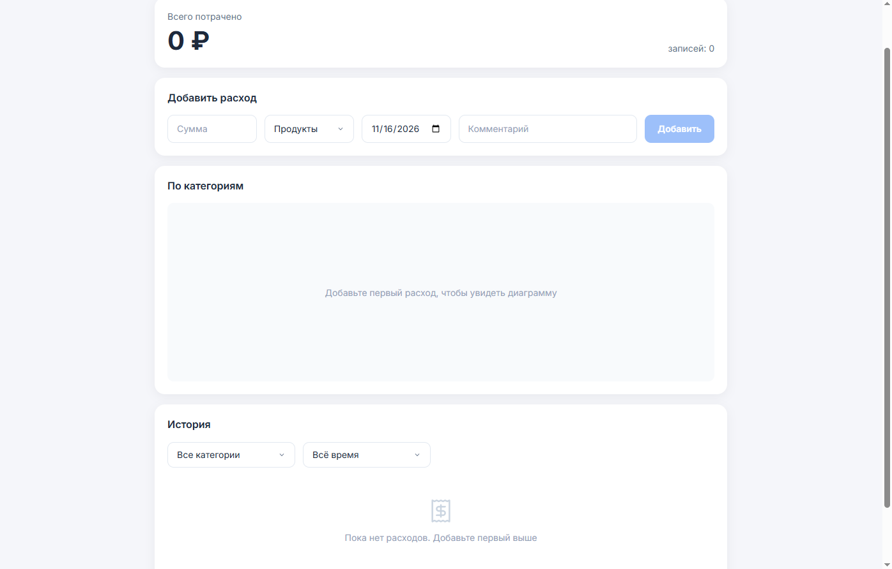

 <div align="center">

# 💸 Expense Tracker

**Простой и удобный трекер личных расходов с категориями и интерактивной диаграммой.**

Добавляй траты, отслеживай общую сумму и смотри, на что уходят деньги. Все записи хранятся локально в браузере — без аккаунта и собственного сервера.


[Открыть приложение](https://stepanwillfil-blip.github.io/expense-tracker/) · [Сообщить об ошибке](https://github.com/stepanwillfil-blip/expense-tracker/issues)

</div>

---

## 📸 Скриншот



---

## 📖 Содержание

- [О проекте](#-о-проекте)
- [Возможности](#-возможности)
- [Технологии](#-технологии)
- [Структура проекта](#-структура-проекта)
- [Запуск локально](#-запуск-локально)
- [Как устроено приложение](#-как-устроено-приложение)
- [Хранение данных и приватность](#-хранение-данных-и-приватность)
- [Публикация на GitHub Pages](#-публикация-на-github-pages)
- [Планы по развитию](#-планы-по-развитию)
- [Контакты](#-контакты)
- [Лицензия](#-лицензия)

---

## 💡 О проекте

**Expense Tracker** — клиентское веб-приложение для учёта личных расходов. Оно помогает записывать повседневные траты, распределять их по категориям и анализировать историю за выбранный период.

Проект создан на чистом HTML, CSS и JavaScript. Для визуализации расходов используется Chart.js, а для сохранения записей — `localStorage` браузера. Бэкенд, регистрация и база данных не нужны.

## ✨ Возможности

### Учёт расходов

- Добавление расхода: сумма, категория, дата и необязательный комментарий.
- Проверка введённых данных: сумма должна быть положительной, дата обязательна.
- Автоматическое сохранение записей в `localStorage`.
- Отображение общей суммы и количества расходов.
- История расходов с датой, категорией, комментарием и суммой.
- Удаление отдельной записи с подтверждением.
- Очистка всей истории с дополнительным подтверждением.

### Категории и фильтры

В приложении предусмотрено 8 категорий:

| Категория | Для чего |
| --- | --- |
| 🛒 Продукты | Покупки продуктов и товаров повседневного спроса |
| 🚕 Транспорт | Проезд и поездки |
| ☕ Кафе | Кафе и рестораны |
| 🎮 Развлечения | Досуг и развлечения |
| 💊 Здоровье | Аптеки и другие расходы на здоровье |
| 👕 Одежда | Одежда и обувь |
| 📱 Связь | Мобильная связь и интернет |
| 📦 Другое | Расходы, которые не подходят под остальные категории |

Историю можно отфильтровать:

- по категории — показать все записи или только выбранную категорию;
- по периоду — сегодня, последние 7 дней, последние 30 дней или всё время.

Фильтрация выполняется отдельно от исходного массива расходов: сами сохранённые записи при этом не изменяются.

### Диаграмма и интерфейс

- Круговая диаграмма типа `doughnut` показывает распределение расходов по категориям.
- В центре диаграммы отображается общая сумма.
- В подсказках диаграммы доступны сумма и процент категории.
- Для каждой категории используется свой цвет.
- Если записей ещё нет, отображается понятное пустое состояние.
- После добавления или удаления расхода список, сумма и диаграмма обновляются.
- Уведомления сообщают об успешном добавлении и удалении записей.

### Адаптивность и доступность

- Вёрстка адаптируется под мобильные устройства, планшеты и компьютеры.
- Форма на небольших экранах перестраивается в одну колонку.
- Интерактивные элементы имеют состояния фокуса `focus-visible`.
- У полей есть связанные подписи, у кнопки удаления — `aria-label`.
- Уведомления об ошибках используют `role="alert"`.

---

## 🧰 Технологии

| Технология | Использование |
| --- | --- |
| **HTML5** | Семантическая разметка и структура приложения |
| **CSS3** | Стили, CSS-переменные, адаптивная вёрстка и состояния интерфейса |
| **JavaScript (ES6+)** | Логика приложения, работа с формами, фильтрами и `localStorage` |
| **Chart.js 4** | Круговая диаграмма расходов с центральной подписью |
| **GitHub Pages** | Публикация статического приложения |

Никаких React, Vue или сборщиков: приложение работает на обычном HTML, CSS и JavaScript.

## 📁 Структура проекта

```text
expense-tracker/
├── index.html       # Разметка приложения
├── style.css        # Стили и адаптивная вёрстка
├── script.js        # Работа с расходами, фильтрами и диаграммой
├── screenshot.png   # Скриншот для README
└── README.md        # Документация проекта
```

## 🚀 Запуск локально

Сборка и установка npm-зависимостей не требуются. Chart.js подключается через CDN.

### Способ 1. Открыть файл

1. Скачай репозиторий через **Code → Download ZIP**.
2. Распакуй архив.
3. Открой `index.html` в браузере.

### Способ 2. Через Live Server

1. Открой папку проекта в Visual Studio Code.
2. Установи расширение **Live Server**, если оно ещё не установлено.
3. Нажми правой кнопкой мыши на `index.html`.
4. Выбери **Open with Live Server**.

Приложение откроется на локальном адресе, который покажет Live Server.

## ⚙️ Как устроено приложение

### Хранение расходов

Записи сохраняются в `localStorage` под ключом `expenses_v1` в формате JSON-массива. Одна запись имеет следующую структуру:

```json
{
  "id": 1737000000000,
  "amount": 350,
  "category": "Продукты",
  "date": "2025-01-15",
  "comment": "Пятёрочка"
}
```

| Поле | Тип | Назначение |
| --- | --- | --- |
| `id` | Number | Идентификатор записи, создаётся при добавлении |
| `amount` | Number | Сумма расхода |
| `category` | String | Категория из списка приложения |
| `date` | String | Дата в формате `YYYY-MM-DD` |
| `comment` | String | Комментарий; может быть пустым |

### Основные функции `script.js`

| Функция | Назначение |
| --- | --- |
| `loadExpenses()` | Загружает и разбирает данные из `localStorage`, обрабатывает некорректные данные |
| `saveExpenses()` | Сохраняет текущий массив расходов в `localStorage` |
| `addExpense(data)` | Проверяет данные и добавляет новую запись |
| `deleteExpense(id)` | Удаляет запись по идентификатору |
| `clearAll()` | Очищает все расходы |
| `renderTotal()` | Обновляет общую сумму и количество записей |
| `renderChart()` | Группирует расходы по категориям и отображает диаграмму |
| `renderList()` | Формирует список расходов с учётом выбранных фильтров |
| `applyFilters()` | Отбирает записи по категории и периоду |
| `formatMoney(n)` | Форматирует сумму с помощью `Intl.NumberFormat` |
| `formatDate(iso)` | Форматирует дату для отображения через `Intl.DateTimeFormat` |

### Как работает диаграмма

Для визуализации используется график `doughnut` из Chart.js:

- `cutout: "70%"` оставляет свободное место в центре диаграммы;
- цвета сегментов задаются через `CATEGORY_COLORS`;
- пользовательский плагин выводит в центре подпись и сумму;
- при обновлении графика предыдущий экземпляр уничтожается через `chart.destroy()`, после чего создаётся новый;
- анимация отключена, чтобы диаграмма не отвлекала при каждом обновлении.

---

## 🔒 Хранение данных и приватность

Приложение не использует собственный сервер или аккаунты. Записи расходов сохраняются в `localStorage` текущего браузера и не отправляются приложением на сервер.

Важно учитывать несколько особенностей:

- Данные доступны только в том браузере и профиле, где они были добавлены. Автоматической синхронизации между устройствами нет.
- Очистка данных сайта или хранилища браузера может удалить сохранённые расходы.
- Chart.js подключается через CDN, поэтому для загрузки библиотеки требуется интернет-соединение. Сами записи расходов при этом не передаются CDN.
- Не используй приложение как единственное место хранения действительно важных финансовых записей: периодически сохраняй резервную копию, когда такая возможность появится.

---

## 🌍 Публикация на GitHub Pages

1. Создай репозиторий `expense-tracker` на GitHub.
2. Загрузи в корень репозитория файлы `index.html`, `style.css`, `script.js`, `screenshot.png` и `README.md`.
3. Открой **Settings → Pages**.
4. В разделе **Build and deployment** выбери:
   - **Source:** `Deploy from a branch`;
   - **Branch:** `main`;
   - **Folder:** `/ (root)`.
5. Нажми **Save**.
6. После публикации приложение будет доступно по адресу:

   **https://stepanwillfil-blip.github.io/expense-tracker/**

---

## 🗺️ Планы по развитию

- [ ] Экспорт истории расходов в CSV.
- [ ] Редактирование существующих записей.
- [ ] Месячный бюджет с индикатором расходов.
- [ ] Линейный график расходов по дням.
- [ ] Светлая и тёмная темы оформления.
- [ ] Создание пользовательских категорий.
- [ ] Резервное копирование и импорт данных.
- [ ] Синхронизация между устройствами — при появлении серверной части.

---

## 📬 Контакты

- **GitHub:** [@stepanwillfil-blip](https://github.com/stepanwillfil-blip)
- **Telegram:** [@SanechkaPozitiv](https://t.me/SanechkaPozitiv)
- **Email:** [stepanwellfill@gmail.com](mailto:stepanwellfill@gmail.com)

---

## 📄 Лицензия

Отдельный файл `LICENSE` для проекта пока не указан. Это означает, что условия свободного копирования, изменения и распространения кода формально не определены. Чтобы разрешить другим использовать проект на понятных условиях, добавь в репозиторий файл лицензии, например MIT.

---

<div align="center">

**Спасибо, что заглянул в проект! ⭐**

</div>
